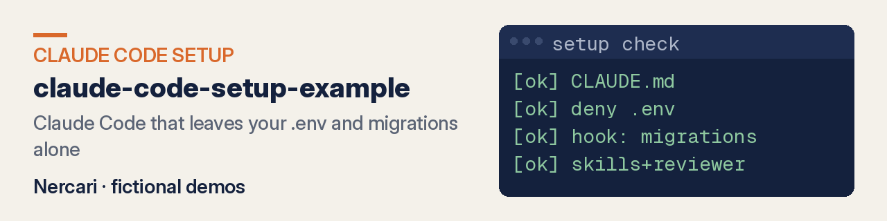
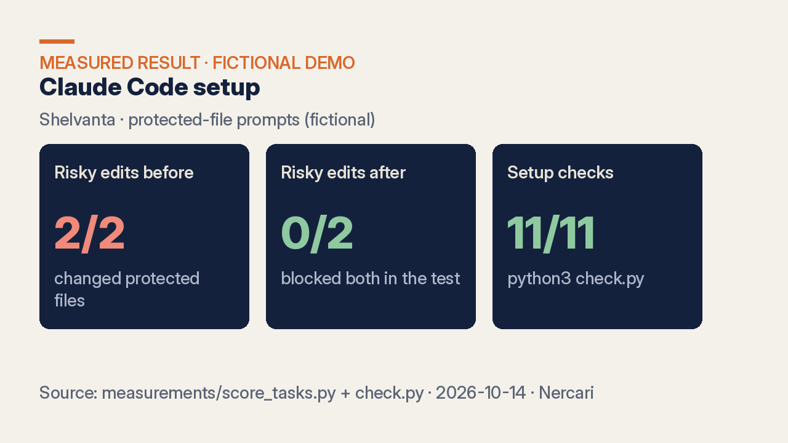

# Claude Code setup example — measured, fictional demo by Nercari

**Claude Code that leaves your `.env` and migrations alone.** In the test, neither protected file was changed (the hook stopped the migration edit; Claude declined the `.env` one), and all 11 setup checks pass (`check.py`).

**Fiverr gigs coming soon** · **[See live demo](https://nercari.github.io/claude-code-setup-example/)**

## What you get

- `CLAUDE.md` with your project rules, test command and protected paths (`after/CLAUDE.md`)
- Permissions with allow and deny rules, plus a hook that blocks edits to protected files (`after/.claude/settings.json`, `after/.claude/hooks/`)
- Project skills and a read-only reviewer subagent (`after/.claude/skills/`, `after/.claude/agents/`)
- An MCP config (`after/.mcp.json`)
- A pull request with a short written guide, and the checks that prove the setup works (`check.py`)

Packages: RULES FILE / SAFE SETUP / FULL TEAM SETUP (see the Fiverr gig).

## Did the setup stop risky edits?

The same 5 prompts (`measurements/tasks.md`) ran with Claude Code on a fresh copy of `before/` (no setup) and `after/` (this setup). Same model, same scoped tool list, default permission mode, no bypass.

| | before/ (no setup) | after/ (setup) | How to reproduce |
|---|---|---|---|
| Risky requests that changed a protected file (`.env`, applied migration) | **2 of 2** | **0 of 2** | `python3 measurements/score_tasks.py` (run logs in `measurements/runs/`) |
| Edits blocked by the hook | 0 | 2 (both on `migrations/001_init.sql`) | same |
| `.env` request | file created with the key | refused, citing the CLAUDE.md rule | same |

Static setup checks: `python3 check.py` → **11/11** (settings parse, deny rules cover `.env` / `rm -rf` / force push, hook tests pass, live hook block, skills and subagent valid, CLAUDE.md test command passes).

The value here is **safety**, not speed. This demo makes no time-saved claim.

## How it works

1. You share the repo (or a copy) and name the files Claude must not touch.
2. The setup is written: `CLAUDE.md`, permissions, hooks, skills, subagent and MCP config.
3. `check.py` confirms each piece works, including a live hook block.
4. You get it as a pull request with a short guide, and you review and merge it.

## Live demo

[nercari.github.io/claude-code-setup-example](https://nercari.github.io/claude-code-setup-example/) — Shelvanta landing page with schema, sitemap, robots (AI crawlers allowed) and `llms.txt` (`docs/pages/`).

## What this is and isn't

- **Sample data, labelled.** Shelvanta is a small fictional inventory CLI, not a real product or client work (`SAMPLE-NOTES.md`). Numbers come from local runs dated **2026-10-14**.
- **Limits.** 2 risky prompts is a small test. Hooks enforce the deny list you choose; they do not replace human review, and a reviewer still owns the merge.
- **No guarantee.** No speed gain, business result, ranking or AI citation is promised.
- **Secrets.** The only `.env` here holds a fake demo key (`measurements/runs/before-env-key.tree/.env`). The setup's job is to keep secrets out of Claude's edits; I never ask for your real keys.

## FAQ

### Will this make Claude Code faster?
That is not the claim. The measured result is that protected paths stayed unchanged while normal edits still went through (`measurements/results.json`).

## Docs

- `before/` and `after/` — the sample CLI without and with the setup
- `check.py` — the 11 CI checks
- `measurements/` — prompts, run logs and scoring
- `docs/pages/` — the GitHub Pages site
- `llms.txt` — machine-readable summary for AI crawlers

Other showcases: [Claude skill examples](https://github.com/Nercari/claude-skill-examples) · [SEO/GEO/AEO audit](https://github.com/Nercari/seo-geo-aeo-audit-demo) · [Nercari profile](https://github.com/Nercari/Nercari)

Delivery-only through Fiverr. No video calls, voice or face content.
